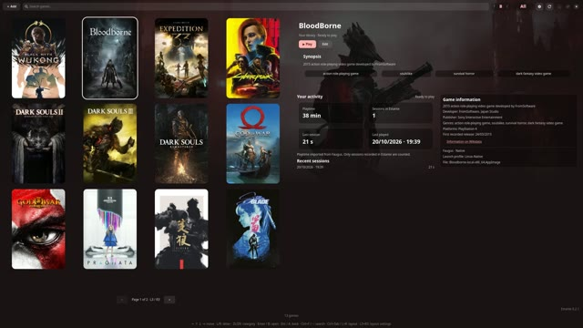
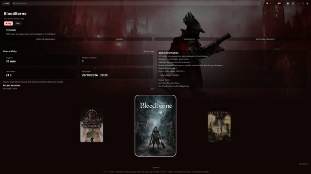
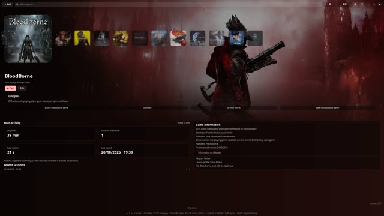
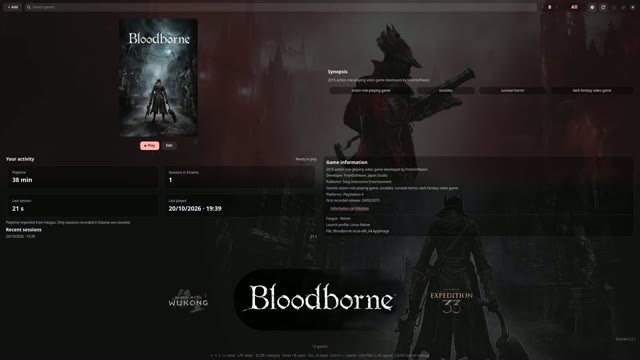
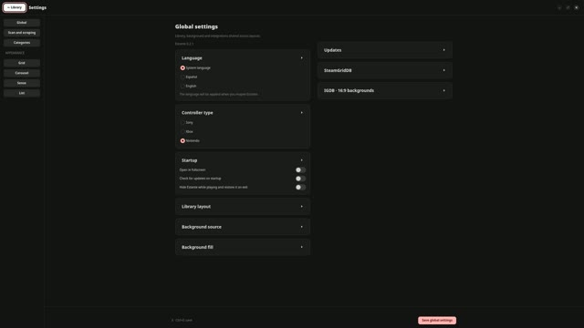

# Estante

Versión: **0.2.1**.

[English documentation](README.en.md)

Una biblioteca de juegos para Linux, sencilla y nativa, inspirada en Cartridges. Reúne juegos de **Steam**, **Faugus Launcher**, scripts **`.sh`** y **AppImages**, con navegación por mando, teclado y ratón.

Estante lee la biblioteca de Faugus directamente: **no necesitas crear archivos `.desktop`**. Al jugar, Faugus se encarga del runner, el prefijo y los parámetros que ya tengas configurados.

Proyecto en desarrollo, construido con Python, GTK 4 y libadwaita.

## Desarrollo con IA y revisión humana

Estante se ha desarrollado con ayuda de inteligencia artificial para generar y modificar código, documentación y pruebas. El proyecto ha pasado por una **revisión humana exhaustiva**, con validación de su comportamiento y decisiones de diseño.

La IA es una herramienta de desarrollo; la responsabilidad sobre los cambios y las versiones publicadas corresponde al responsable del proyecto. Esta revisión no garantiza la ausencia de errores: los problemas detectados pueden comunicarse mediante las incidencias del repositorio.

## Funciones

- Importación manual de Steam y Faugus desde Ajustes, tanto nativos como Flatpak, con categorías por origen.
- Juegos locales con parámetros y directorio de trabajo personalizados.
- Cuatro apariencias: **Grid**, **Carousel**, **Sense** y **Lista**.
- Categorías propias, búsqueda y navegación rápida por inicial.
- Carátulas verticales y cuadradas, banners y fondos personalizados.
- Información del juego desde Wikidata o editada a mano.
- Tiempo jugado, estadísticas y sesiones recientes.
- Edición en paneles laterales superpuestos, sin desplazar la biblioteca.

## Apariencias y vídeos

Elige la distribución que prefieras sin cambiar tu biblioteca. Cada apariencia tiene sus propios ajustes de carátulas, selección y fondos. Los vídeos muestran **Estante 0.2.1**; haz clic en una vista previa para abrir su MP4.

### Grid

Una cuadrícula de carátulas con la ficha y la actividad del juego seleccionado en el panel de la derecha. Permite elegir formato vertical o cuadrado, tamaño y esquinas. En 0.2.1, la biblioteca se divide en páginas de **12 juegos**: usa **L3 / R3**, los botones de página o **Ctrl+RePág / Ctrl+AvPág** para recorrerlas.

[](docs/showcase/01-grid.mp4)

[▶ Ver Grid](docs/showcase/01-grid.mp4)

### Carousel

Una rueda horizontal con profundidad y navegación circular continua. El juego seleccionado permanece en el centro y se destaca con un zoom configurable. Puedes colocar la rueda arriba o abajo, mientras consultas la sinopsis, información y actividad del juego.

[](docs/showcase/02-carousel.mp4)

[▶ Ver Carousel](docs/showcase/02-carousel.mp4)

### Sense

Una fila compacta de carátulas sobre el fondo del juego. La selección permanece anclada a la izquierda y los juegos se desplazan al navegar. El tamaño de la carátula seleccionada y su animación suave son configurables.

[](docs/showcase/03-sense.mp4)

[▶ Ver Sense](docs/showcase/03-sense.mp4)

### Lista

Una rueda de logos con el seleccionado destacado, acompañada de su carátula, sinopsis y datos. Colócala en cualquiera de los cuatro lados de la pantalla: la navegación es vertical en los laterales y horizontal arriba o abajo. Puedes ajustar por separado el tamaño de los logos, el logo seleccionado y la carátula.

[](docs/showcase/04-list.mp4)

[▶ Ver Lista](docs/showcase/04-list.mp4)

### Ajustes

Los ajustes globales reúnen idioma, tipo de mando, inicio, integraciones y origen del fondo. Cada apariencia dispone de su propia configuración visual, organizada en secciones desplegables. **L3 + R3** abre directamente los ajustes de la apariencia actual; también puedes entrar desde el engranaje.

[](docs/showcase/05-settings.mp4)

[▶ Ver Ajustes](docs/showcase/05-settings.mp4)

## AppImage

La versión AppImage para **Linux x86_64** incluye Python, PyGObject, GTK, libadwaita
y SDL2. No necesita instalar esas bibliotecas ni ejecutar el instalador nativo.

### Instalar con Gear Lever (recomendado)

Recomendamos [Gear Lever](https://github.com/mijorus/gearlever) para organizar el
AppImage e integrar Estante en el menú de aplicaciones con su icono.

1. Instala Gear Lever desde [Flathub](https://flathub.org/apps/it.mijorus.gearlever).
2. Descarga `Estante-0.2.1-x86_64.AppImage`.
3. Abre el archivo con Gear Lever y utiliza su opción de integración en el menú.
4. Abre **Estante** desde el lanzador de tu escritorio.

Si ya tienes Flatpak y Flathub configurados, puedes instalar Gear Lever con:

```sh
flatpak install flathub it.mijorus.gearlever
```

### Ejecutar sin instalar

Si prefieres gestionar el archivo a mano:

```sh
chmod +x Estante-0.2.1-x86_64.AppImage
./Estante-0.2.1-x86_64.AppImage
```

La versión aparece en el pie de la biblioteca y en **Ajustes → Globales**.
También puedes consultarla con `./Estante-0.2.1-x86_64.AppImage --version`.

Puedes mover el archivo a la carpeta que prefieras. Los datos siguen guardándose en
la ubicación habitual de Estante. Faugus debe estar instalado aparte para ejecutar
los juegos que administra.

### Ejecutar sin FUSE

El runtime necesita FUSE para montar el archivo. Si FUSE no está disponible, puedes
extraerlo y ejecutarlo sin montar:

```sh
./Estante-0.2.1-x86_64.AppImage --appimage-extract
./squashfs-root/AppRun
```

El paquete se comprueba con una prueba de dependencias y decodificación de imágenes.
La compatibilidad gráfica en otras distribuciones todavía necesita validación;
no se ofrece una versión ARM en este momento.

### Actualizar el AppImage

En **Ajustes → Globales → Actualizaciones**, pulsa **Buscar actualizaciones**.
Si hay una versión estable más reciente, **Descargar e instalar** verifica la descarga
mediante SHA-256 y sustituye el AppImage actual. Cierra y vuelve a abrir Estante para
utilizar la nueva versión. Los ajustes, la biblioteca y las imágenes se conservan.

El archivo debe estar en una carpeta donde tu usuario pueda escribir; esto también
permite actualizar la copia que gestiona Gear Lever. Las comprobaciones se hacen al
pulsar el botón, sin descargas automáticas en segundo plano.

Las actualizaciones se obtienen de las [releases públicas del proyecto](https://github.com/gsanmartindougan/Estante/releases).
Subir código o crear una etiqueta no basta: cada release debe tener una etiqueta
`vX.Y.Z` y el archivo `Estante-X.Y.Z-x86_64.AppImage`. Se utiliza la suma `digest`
que devuelve la [API de GitHub](https://docs.github.com/en/rest/releases/releases).
Si todavía no hay una release, falta el archivo o no hay conexión, la aplicación lo indica.

También puedes descargar la nueva versión y gestionarla con Gear Lever o sustituir
el archivo a mano. En instalaciones nativas y al ejecutar desde el código fuente,
Estante puede buscar versiones y enlazar a la descarga; la instalación se actualiza
con `install.sh` como se explica más abajo.

### Desinstalar el AppImage

- **Con Gear Lever:** selecciona Estante en Gear Lever y utiliza su opción de
  eliminación para retirar el AppImage, el acceso del menú y los iconos asociados.
- **Sin Gear Lever:** cierra Estante y elimina el archivo `.AppImage`. Si lo habías
  extraído, elimina también la carpeta `squashfs-root` correspondiente a Estante.
  Si creaste un acceso al menú manualmente, retíralo también.

No se usa `install.sh --uninstall` para desinstalar un AppImage. La biblioteca,
los ajustes, las estadísticas y las imágenes personales se conservan en ambos casos.

## Instalación nativa y ejecución

Puedes instalar Estante como aplicación, con icono en el menú, sin mantener abierta
la carpeta del proyecto. El instalador funciona en las distribuciones Linux que
dispongan de las dependencias siguientes; no es un AppImage autocontenido.

Requiere Linux, Python 3, PyGObject, GTK 4.10 o posterior y libadwaita. Para usar un mando también necesitas SDL2. No requiere instalar paquetes con `pip`.

### Fedora

```sh
sudo dnf install python3 python3-gobject gtk4 libadwaita SDL2
```

### Arch Linux

```sh
sudo pacman -S python python-gobject gtk4 libadwaita sdl2
```

Si tu distribución utiliza `sdl2-compat`, puedes usarlo en lugar de `sdl2`.

### Ubuntu 24.04 o posterior / Debian 13 o posterior

```sh
sudo apt install python3 python3-gi gir1.2-gtk-4.0 gir1.2-adw-1 gir1.2-gdkpixbuf-2.0 libsdl2-2.0-0
```

En otras distribuciones, instala los paquetes equivalentes. El instalador comprueba
PyGObject, GTK y libadwaita antes de copiar la aplicación.

### Instalar desde el paquete descargable

Descomprime `Estante-0.2.1-linux.tar.gz`, entra en la carpeta y ejecuta:

```sh
tar -xzf Estante-0.2.1-linux.tar.gz
cd Estante
sh install.sh
```

La instalación predeterminada es para tu usuario, en `~/.local`, sin `sudo`.
Abre **Estante** desde el menú de aplicaciones o ejecuta `~/.local/bin/estante`.
Si `~/.local/bin` está en tu `PATH`, también puedes ejecutar `estante`.
Puedes borrar la carpeta extraída después de instalar.

Para instalar para todos los usuarios, en `/usr/local`:

```sh
sudo sh install.sh --system
```

### Actualizar la instalación nativa

Descarga y descomprime el nuevo paquete. Ejecuta `sh install.sh` para actualizar
la instalación del usuario, o `sudo sh install.sh --system` si instalaste para todos
los usuarios. Los datos personales se conservan.

### Desinstalar la instalación nativa

Desde la carpeta del proyecto o una copia descomprimida del instalador, utiliza
el comando correspondiente a tu instalación.

Para la instalación del usuario (`~/.local`):

```sh
sh install.sh --uninstall
```

Para la instalación de todo el sistema (`/usr/local`):

```sh
sudo sh install.sh --system --uninstall
```

La desinstalación conserva juegos, ajustes e imágenes.

Si ya borraste la carpeta del instalador, vuelve a descargarla y descomprimirla
para ejecutar la desinstalación. Si instalaste con `--prefix`, utiliza ese mismo
prefijo al actualizar o desinstalar, por ejemplo `sh install.sh --prefix /ruta --uninstall`.

### Instalar desde el código fuente

```sh
git clone https://github.com/gsanmartindougan/Estante.git
cd Estante
sh install.sh
```

También puedes ejecutar `python3 estante.py` desde la carpeta del proyecto.

## Añadir juegos

### Faugus Launcher

La importación es manual: abre **Ajustes → Escaneo y scraping → Escanear Faugus**. Repite el escaneo cuando añadas juegos o quieras actualizar sus datos de Faugus. Los juegos ya importados se conservan.

Estante consulta las ubicaciones XDG, las ubicaciones heredadas y los datos de la instalación Flatpak. La integración necesita una versión de Faugus que admita `--game ID`.

Los cambios de carátulas, categorías y fichas se guardan en Estante. Su editor no modifica la configuración de Faugus.

### Scripts y AppImages

Pulsa **Añadir** y selecciona el archivo. Puedes indicar su nombre, parámetros y directorio de trabajo.

Los scripts se ejecutan con Bash. Las AppImages necesitan permiso de ejecución. Los parámetros admiten comillas, por ejemplo `--fullscreen --profile "Mi perfil"`, y se pasan como argumentos sin evaluarlos mediante un shell.

Un clic selecciona un juego; **Jugar** lo ejecuta y **Editar** abre sus opciones. Un doble clic también lo ejecuta.

## Apariencias y personalización

### Idioma

El idioma inicial se elige según el sistema: **español** si el sistema está en
español; **inglés** para cualquier otro idioma. En **Ajustes → Globales → Idioma**
puedes elegir **Idioma del sistema**, **Español** o **English**. Guarda los ajustes
y vuelve a abrir Estante para aplicar el cambio. Los nombres y las fichas que
hayas guardado no se traducen ni se sobrescriben.

### Distribución

En la versión 0.2.1 puedes elegir dos fondos por juego desde **Editar → Cambiar banner…**
y **Elegir segundo fondo…**. Ambos admiten las mismas fuentes de imágenes.
En **Ajustes → Apariencia → Grid / Carousel / Sense / Lista → División de los fondos**, elige:

- **Un solo fondo**: mantiene el comportamiento anterior.
- **Horizontal**: un fondo arriba y otro abajo.
- **Vertical**: un fondo a la izquierda y otro a la derecha.
- **Diagonal**: reparte el área entre las dos imágenes mediante un corte diagonal.

La división se guarda por apariencia y reparte toda la ventana entre los dos heroes.
La posición del hero ajusta el recorte dentro de su propia mitad. El relleno
desenfocado o de color predominante también utiliza ambos fondos. Si no hay segundo
fondo, se muestra el primero. **Quitar segundo fondo** elimina su asociación sin borrar
el archivo ni cambiar el primero.

El engranaje abre una vista de ajustes con opciones **Globales**, **Categorías** y una página por apariencia.

El botón **Guardar** y los mensajes de confirmación permanecen visibles al pie de
cada sección. Puedes guardar la sección abierta con **Y / Triángulo** del mando o
**Ctrl+S**, sin desplazarte hasta el final. Las categorías se guardan con sus propias acciones.

| Apariencia | Distribución |
| --- | --- |
| **Grid** | Cuadrícula de carátulas a la izquierda y datos del juego a la derecha. |
| **Carousel** | Rueda circular horizontal con profundidad, giro animado y selección centrada. Una carátula por juego. |
| **Sense** | Fila compacta que se desplaza alrededor de una selección fija a la izquierda. |
| **Lista** | Rueda de logos en cualquiera de los cuatro lados, con carátula y datos del seleccionado. |

Cada apariencia permite elegir carátulas **cuadradas (1:1)** o **verticales (2:3)**, redondeado de esquinas, color y grosor del anillo de selección, o quitar el anillo. El formato cuadrado utiliza su propio asset; no recorta la carátula vertical.

Grid permite ajustar el zoom de las carátulas. Carousel permite ajustar el zoom del juego seleccionado y colocar la rueda abajo. Sense permite ajustar el tamaño del juego seleccionado y activar su animación suave.

La posición del hero también se guarda **por apariencia**: arriba, abajo o a pantalla completa. El fondo cambia con el juego seleccionado, sin depender de pasar el cursor sobre él. El relleno desenfocado o con el color predominante del hero se configura en Globales.

Pulsa **Guardar globales** o **Guardar aspecto**, según la página, para aplicar los cambios.

## Categorías

En **Ajustes → Categorías** puedes crear, renombrar y eliminar categorías, incluso si todavía no tienen juegos.

Para asignarlas, abre **Editar → Categorías…** y marca las que correspondan. Un juego puede pertenecer a varias. Eliminar una categoría no elimina sus juegos.

El selector junto a la búsqueda muestra la categoría actual en el centro y las vecinas a los lados. **Todos** muestra la biblioteca completa; la búsqueda se combina con la categoría activa.

## Controles

| Acción | Teclado | Mando |
| --- | --- | --- |
| Mover el foco | Flechas / Tab | Cruceta o stick izquierdo |
| Confirmar o activar | Enter / Espacio | A / Cruz |
| Volver | Escape | B / Círculo |
| Buscar | Ctrl+F o `/` | Select / Back; también X / Cuadrado |
| Cambiar apariencia | Ctrl+Tab (Shift: anterior) | LB + RB · L1 + R1 |
| Letra anterior o siguiente | — | LB/RB · L1/R1 |
| Categoría anterior o siguiente | RePág / AvPág | LT/RT · L2/R2 |
| Ajustes | Engranaje | Start |

Los bumpers saltan entre las iniciales que tienen juegos en el filtro actual. Mantenerlos pulsados repite el salto. Los gatillos cambian una categoría por pulsación.

En las vistas horizontales, baja para acceder a las acciones del juego y sube para volver a las carátulas. Si Carousel está colocado abajo, se invierten esas direcciones.

El mando se detecta al conectarlo y solo actúa cuando Estante está activo. Al usarlo se oculta el cursor; mover el ratón vuelve a mostrarlo. También puedes navegar por los ajustes y las galerías de imágenes con mando o teclado.

## Carátulas y fondos

Desde **Editar** puedes cambiar la carátula vertical, la cuadrada y el banner de forma independiente.

| Fuente | Uso y requisitos |
| --- | --- |
| **SteamGridDB** | Carátulas y heroes. Necesita tu [clave API](https://www.steamgriddb.com/profile/preferences/api). |
| **Steam** | Capturas 16:9 de juegos disponibles en su tienda. Sin credenciales. |
| **IGDB** | Artworks y capturas 16:9 de juegos de distintas plataformas. Necesita credenciales de Twitch. |
| **Archivo local o URL** | Tus propias imágenes, sin claves API. La URL debe apuntar directamente a una imagen. |

Las credenciales se introducen en **Ajustes → Globales**. Para IGDB, crea una aplicación en la [consola de Twitch](https://dev.twitch.tv/console/apps) y sigue la [documentación de IGDB](https://api-docs.igdb.com/#account-creation) para obtener el Client ID y el Client Secret.

La galería presenta las imágenes en dos columnas. Los resultados de SteamGridDB muestran resolución y peso del archivo original cuando puede consultarse. Las carátulas conservan sus píxeles originales para evitar perder nitidez al ampliar.

Los heroes de SteamGridDB suelen ser panorámicos; para fondos 16:9 puedes usar Steam o IGDB. En IGDB se filtran imágenes cercanas a 16:9 y de al menos 1280 píxeles de ancho. La disponibilidad depende del juego.

Las imágenes elegidas se copian o descargan a la biblioteca local. Sin credenciales puedes utilizar las carátulas existentes de Faugus, archivos locales y el resto de funciones locales.

## Fichas y actividad

**Buscar ficha del juego** consulta Wikidata sin clave API y permite escoger una coincidencia. Se guardan los datos disponibles: estudio, editora, lanzamiento, géneros, plataformas y descripción. **Editar ficha a mano** permite completar o corregir esa información.

Faugus aporta su tiempo jugado acumulado. Estante registra por separado las sesiones completadas desde su ventana, sin sumarlas de nuevo al tiempo importado. Para scripts y AppImages, el tiempo se acumula localmente.

Si cierras Estante antes de que termine el juego, esa sesión no se registra en Estante. Cerrar la aplicación deja los juegos abiertos.

## Datos locales

La biblioteca, las preferencias, las imágenes y las credenciales se guardan en:

```text
~/.local/share/estante/
```

Se respeta `$XDG_DATA_HOME/estante`. Las credenciales están en `settings.json`, con permisos exclusivos del usuario. No compartas ese archivo.

Quitar un juego local de la biblioteca conserva su archivo original. Los mensajes del último lanzamiento están en `launch.log`, dentro de la carpeta de datos; cada lanzamiento reemplaza ese registro.

Para usar otra carpeta de datos de Estante:

```sh
ESTANTE_DATA_DIR=/tmp/estante-demo sh run.sh
```

Esta variable cambia los datos propios de Estante; la lectura de Faugus sigue usando sus ubicaciones habituales.

## Desarrollo y pruebas

Para generar el instalador nativo, sin incluir datos personales ni credenciales:

```sh
python3 packaging/build-release.py
```

El resultado es `dist/Estante-0.2.1-linux.tar.gz`. Generarlo no lo publica en GitHub.
El instalador también admite `--prefix` y `--destdir` para preparar paquetes de distribución.

### Construir el AppImage

La versión se define en `version.py`; ambos constructores la incorporan al nombre
del archivo generado.

Con Python, GTK, libadwaita, SDL2, `ldd`, `glib-compile-schemas` y el AppImage de
**appimage-builder** disponibles en la máquina de construcción:

```sh
python3 packaging/build-appimage.py --builder ~/Applications/appimagebuilder.appimage
```

El constructor usa el runtime Type 2 y `mksquashfs` incluidos en ese archivo para
generar `dist/Estante-0.2.1-x86_64.AppImage` sin descargar herramientas adicionales.
Incluye las dependencias locales y ejecuta `--self-test` antes de comprimir y después
de extraer el resultado. No necesita Docker ni FUSE para construir.

La carpeta temporal de trabajo se conserva en `dist/Estante.AppDir`. Antes de volver
a construir, muévela o elimínala. Puedes indicar otra salida con `--output` o preparar
solo la carpeta con `--appdir-only`. Para comprobar un paquete extraído:

```sh
./squashfs-root/AppRun --self-test
```

Esta construcción usa las versiones de la máquina de origen. Antes de distribuirla,
conviene probar el AppImage en otras distribuciones y en Wayland y X11. No se publica
ni sube ningún archivo automáticamente.

```sh
python3 -m unittest discover -s tests -v
```

La comprobación gráfica requiere una sesión de escritorio:

```sh
python3 tests/check_ui.py
```

Las pruebas utilizan datos temporales y mocks para los servicios externos; no necesitan tus credenciales ni ejecutar juegos reales de la biblioteca.

### Modo Lista

Divide la biblioteca en dos: logos a la izquierda y datos del juego a la derecha. Arriba/abajo, la cruceta o el stick recorren el carrusel vertical circular, con el juego seleccionado centrado. La rueda del ratón también cambia de juego. Derecha lleva a Jugar/Editar; izquierda vuelve a la lista.

Los logos se obtienen de SteamGridDB si hay una clave API y una coincidencia inequívoca. Puedes elegir otro desde **Editar → Logo**, también desde un archivo local o una URL. Si falta el logo se muestra el título. En **Ajustes → Lista** puedes ajustar su tamaño, el anillo de selección y los fondos independientemente del resto de apariencias. Ctrl+Tab o LB+RB incluyen Lista al alternar apariencias.

En **Ajustes → Categorías** también puedes buscar y marcar los juegos de cada categoría, cambiar su orden con **Subir/Bajar** y elegir la **categoría principal** que se abre al iniciar Estante. Por defecto es **Todos**. El orden se aplica al selector y a los gatillos del mando. Los cambios se guardan automáticamente; renombrar la principal conserva su elección y eliminarla vuelve a Todos.


### Escaneo y scraping manual

En **Ajustes → Escaneo y scraping**, el escaneo importa juegos de Faugus sin modificar sus archivos. Al actualizar desde una versión con importación automática se conserva una instantánea de la biblioteca anterior; después solo se importa al pulsar **Escanear Faugus**.

El scraping procesa toda la biblioteca y permite elegir imágenes (SteamGridDB, requiere una clave guardada) e información (Wikidata). **Completar datos faltantes** conserva imágenes válidas y campos ya rellenados; **Reemplazar existentes** actualiza lo disponible sin borrar los datos para los que no haya resultados. Las coincidencias ambiguas se omiten. Las imágenes no se descargan automáticamente al navegar. Puedes seguir eligiendo imágenes y fichas individualmente desde Editar.

### Importar Steam y Faugus

En **Ajustes → Escaneo y scraping** puedes pulsar **Escanear Steam** o **Escanear Faugus**. Steam importa juegos instalados desde sus manifiestos locales y las bibliotecas configuradas en otros discos, sin pedir credenciales ni una clave API. Se omiten Proton, los runtimes y las herramientas comunes de Steam. Los juegos se inician con el cliente Steam correspondiente, nativo o Flatpak.

Los escaneos asignan las categorías **Steam** y **Faugus** y conservan las demás categorías y personalizaciones. Las entradas de Faugus con runner **Steam** o una dirección `steam://` se omiten, incluidas las importadas anteriormente. No se deduplica por título ni por nombres de ejecutables, para conservar juegos independientes que tengan «Steam» en su nombre. Los archivos de Steam y Faugus se leen sin modificarlos.

Para quitar un juego, abre **Editar → Organización → Quitar de la biblioteca**. No se borra ni se desinstala. Los importados de Steam y Faugus quedan excluidos de futuros escaneos; puedes recuperarlos desde **Ajustes → Escaneo y scraping → Juegos quitados → Restaurar juegos quitados**, con sus personalizaciones. Los scripts y AppImages locales pueden añadirse de nuevo desde Añadir.

En **Ajustes → Lista → Posición de la lista** puedes situar la rueda a la izquierda, derecha, arriba o abajo. Los datos quedan en el lado opuesto. En los laterales navegas con arriba/abajo; en los bordes superior e inferior, con izquierda/derecha. La dirección hacia los datos enfoca Jugar/Editar y la dirección hacia la rueda vuelve a los logos.
